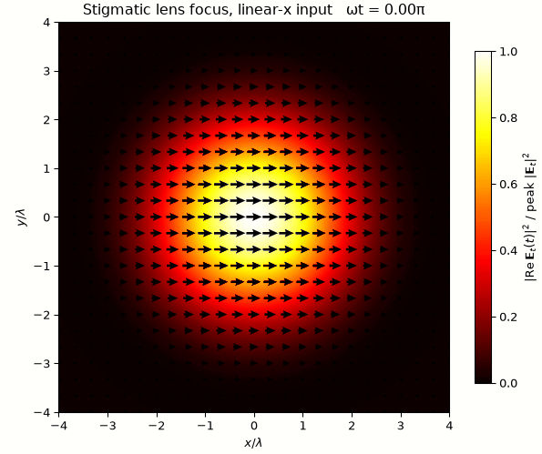
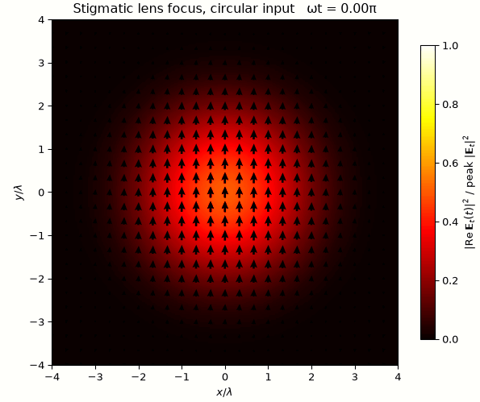
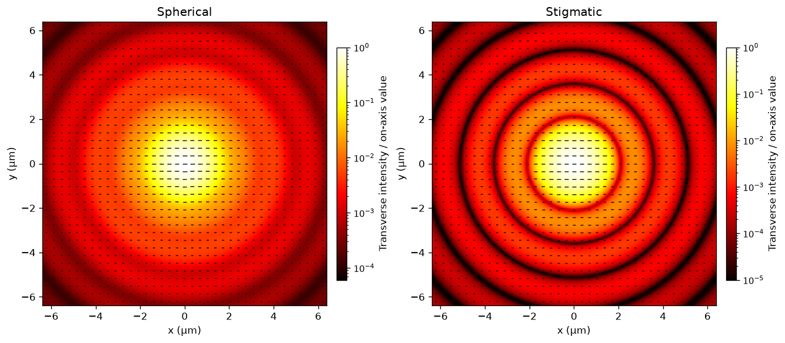
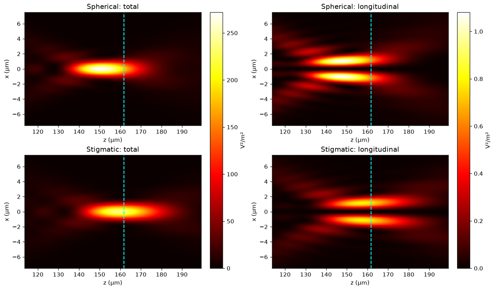
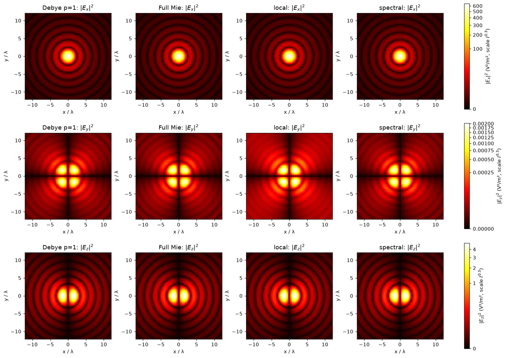
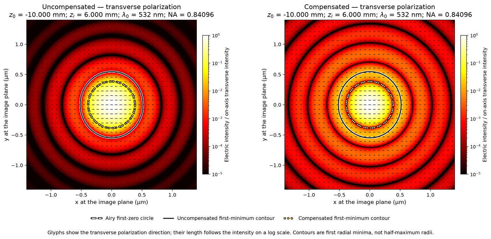
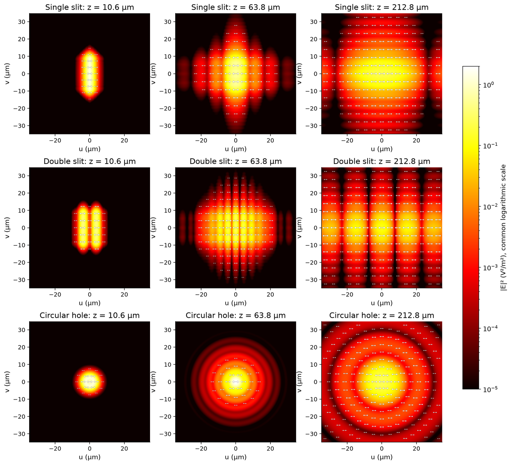
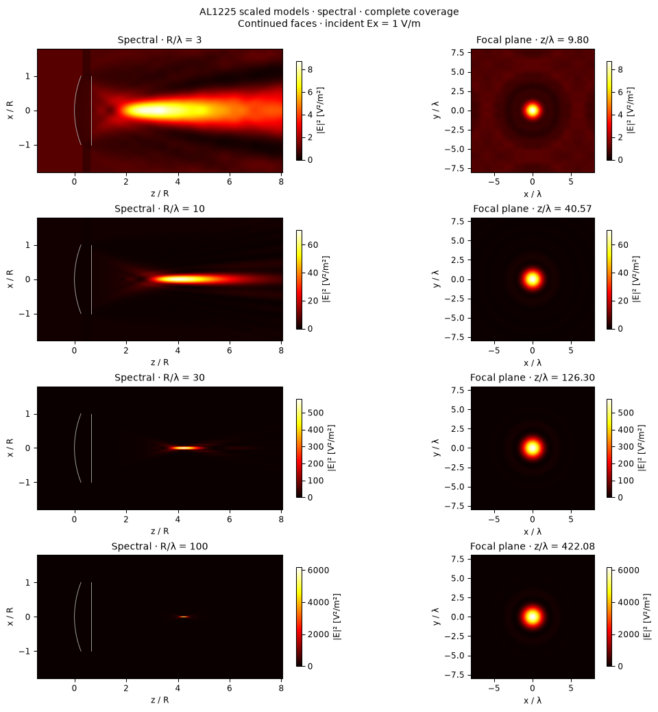

# vecdiff

Vector electromagnetic propagation through optical systems: angular-spectrum
propagation, refraction and reflection at curved dielectric interfaces with
per-wavevector Fresnel transmission, and focusing to the image plane.

<p align="center">
  
  
</p>

<p align="center">
  <em>Instantaneous focal field <code>Re[E e<sup>-i&omega;t</sup>]</code> of the Cartesian-oval
  lens of notebook 03 over two optical cycles: arrows show the transverse field over its
  time-averaged intensity (scale I<sup>0.3</sup>, so the secondary maxima stay visible).
  Linear-x input (left) oscillates; circular input (right) rotates.</em>
</p>

## Results

Figures from the executed [notebooks](docs/NOTEBOOKS.md), all computed with the current code.

<p align="center">
  
</p>

**Lens focusing (notebook 03).** A plane–convex glass lens (n = 1.5, exit radius 120λ, λ = 532 nm)
through `PropagationPipeline` with spectral Fresnel transmission. Focal-plane transverse intensity and
polarization: the spherical exit face (left) blurs the focus by spherical aberration; the Cartesian-oval
exit face (right) gives a sharp Airy pattern with dark rings.

<p align="center">
  
</p>

**Through focus (notebook 03).** Total and longitudinal (|E<sub>z</sub>|²) electric intensity in the
meridional plane for both exit faces (scale I<sup>0.3</sup>); the dashed line marks the nominal image plane.

<p align="center">
  
</p>

**Macroscopic sphere, R/λ = 100 (notebook 07).** Focal |E<sub>x</sub>|², |E<sub>y</sub>|², |E<sub>z</sub>|²
from local and spectral Fresnel propagation through the same glass sphere (n = 1.5, illumination
radius 35λ), beside the first transmitted Debye term (p = 1) and the full Mie field, which includes
additional scattering (scale I<sup>0.3</sup>, so the rings are visible).

<p align="center">
  
</p>

**Fresnel compensation in a stigmatic diopter (notebook 04).** Ray-tube/Debye focus at NA ≈ 0.84 with
and without compensating the Fresnel transmission. The compensated first minimum (gold dashes) lies on
the Airy first-zero circle (black); the uncompensated one (cyan) is wider.

<p align="center">
  
</p>

**Diffraction by apertures (notebook 02).** Vector angular-spectrum propagation behind a single slit,
a double slit and a circular hole at three distances, on a common I<sup>0.3</sup> intensity scale, with
the transverse polarization.

<p align="center">
  
</p>

**Thorlabs AL1225 (notebook 06).** Spectral pipeline fields of the catalog asphere, geometrically
scaled to R/λ = 3, 10, 30 and 100: meridional and focal-plane |E|².

## Documentation

- [Notebooks](docs/NOTEBOOKS.md): seven executed optical studies using the current methods.
- [Architecture](docs/ARCHITECTURE.md): responsibilities, units and source map.
- [Propagation](docs/PROPAGATION.md): homogeneous propagation and the R Q⁻¹ T Q R path.
- [Fourier API and grids](docs/FOURIER_AND_GRIDS.md): Cartesian, polar and nonuniform transforms with physical coordinates.
- [Validation](docs/VALIDATION.md): tests, full-wave references (BEM, FEM, Mie) and their limits.

## Install and verify

Python 3.10 or newer is required. The build also needs a C
compiler and a Fortran compiler (tested with gfortran). Run from this directory:

```sh
python3 -m venv .venv
.venv/bin/python -m pip install meson-python ninja 'numpy>=2'
.venv/bin/python -m pip install --no-build-isolation -e './general[test,notebooks,nufft,reference-mesh]'
.venv/bin/python -m pip install -e './stigmatic[test,notebooks,nufft]' ruff
.venv/bin/python -m pytest -q
.venv/bin/ruff check .
.venv/bin/ruff format --check .
```

NumPy and SciPy are required. Matplotlib, Jupyter execution, FINUFFT and Gmsh
(`reference-mesh`) are optional extras. `requirements-dev.lock` records the
qualified development environment; the root `pyproject.toml` configures code
style. See [notebooks](docs/NOTEBOOKS.md) to execute the notebooks.

## Organization

The code separates physical data from algorithms:

```text
vecdiff_general/
    geometry/       coordinate frames
    surfaces/       surface shapes and normals
    sampling/       grids and integration measures
    media/          material properties and spatial assignment
    fields/         field samples, spectra and source representations
    system.py       surface/media adjacency and optical prescriptions
    fourier/        numerical transforms
    propagation/
        homogeneous.py          propagation in a homogeneous medium (ASM/Fresnel)
        surface_transfer.py     surface trace Q and outgoing reconstruction
        surface_interaction.py  transmission and reflection at a boundary
        pipeline.py             composition along an optical path
        references/             Mie, BEM and independent reference solutions
    observables/    energy, power, polarization and detector formation
    visualization/  plots and animations
```

Angular-spectrum **construction** belongs to `fields/`; evolution in a
homogeneous medium belongs to `propagation/homogeneous.py`. Surface geometry
and adjacent materials are specified independently of the interaction model.
A pipeline can contain zero, one or several optical boundaries.

External comparisons live in `validation/`.

## Physical contracts

- Lengths and vacuum wavelength are metres. Public E and H are SI phasors in V/m and A/m; time dependence is `exp(-i omega t)`.
- `ElectricField(grid, wavelength0, values)` owns electric samples, with convenient `Ex`, `Ey`, `Ez` views. It has no medium or duplicate sampling state.
- `Grid` owns physical coordinates, placement, and any integration measure. `PlaneGrid` components use a declared right-handed frame; complete E values are global Cartesian vectors.
- `TransverseElectricField` prescribes two local plane components. Longitudinal completion needs the material dispersion and a branch supplied separately. A complete electric vector is validated, never silently projected.
- Material context belongs to regions and systems. `MaterialDistribution` represents piecewise spatial `n(r)`; a geometrical body does not imply that a solver includes its rim scattering.
- A solution computes consistent H from its spatial/modal representation. `ElectromagneticField` holds evaluated E/H; its `poynting()` and `power()` preserve coherent interference.
- `norm2()` is electric amplitude squared. It is not labeled intensity in W/m². Energy density takes explicit nondispersive material context.

## A propagation

```python
import numpy as np
import vecdiff_general as optics

wavelength = 532e-9
region = optics.HomogeneousRegion("air", optics.Dielectric(1.0))
axis = (np.arange(64) - 32) * wavelength / 2
grid = optics.PlaneGrid(axis, axis)

radius_squared = np.sum(grid.points[..., :2] ** 2, axis=-1)
envelope = np.exp(-radius_squared / (3 * wavelength) ** 2)
values = np.stack((envelope, 0.3j * envelope), axis=-1)
electric = optics.TransverseElectricField(grid, wavelength, values)

spectrum = optics.angular_spectrum(electric, region, evanescent="discard")
propagated = spectrum.propagate(10 * wavelength, model="asm")
power_in_watts = propagated.power()
```

An interface normal points from its `minus` region into its `plus` region. `scatter_plane` retains reflected and transmitted expansions, including evanescent transmission under TIR. `PropagationPipeline(system, transmission="local" | "spectral")` accepts an existing incident field and a target (`z=f`, `y=a`, `x=b`, or a placed surface), returning an `ElectricField`; see the [pipeline example](general/examples/propagation_pipeline.py).

## Qualification and limits

Read [validation](docs/VALIDATION.md) for the reference checks and measured
errors. The curved-surface pipeline is a forward approximation. Its current
transport uses a finite, periodic FFT chart and a declared propagating angular
band. Finite material edges, stops and returning branches are outside this
pipeline's supported model. Exact planar scattering and complete reference
transfer have different, explicitly documented spectral coverage.
