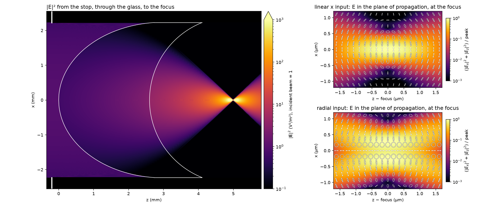
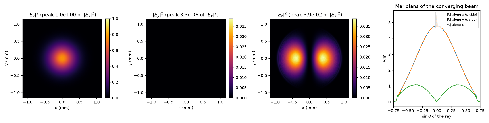
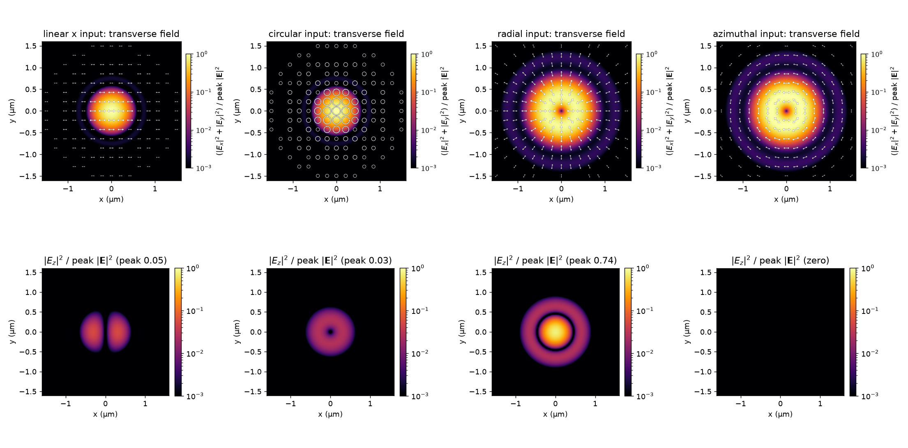
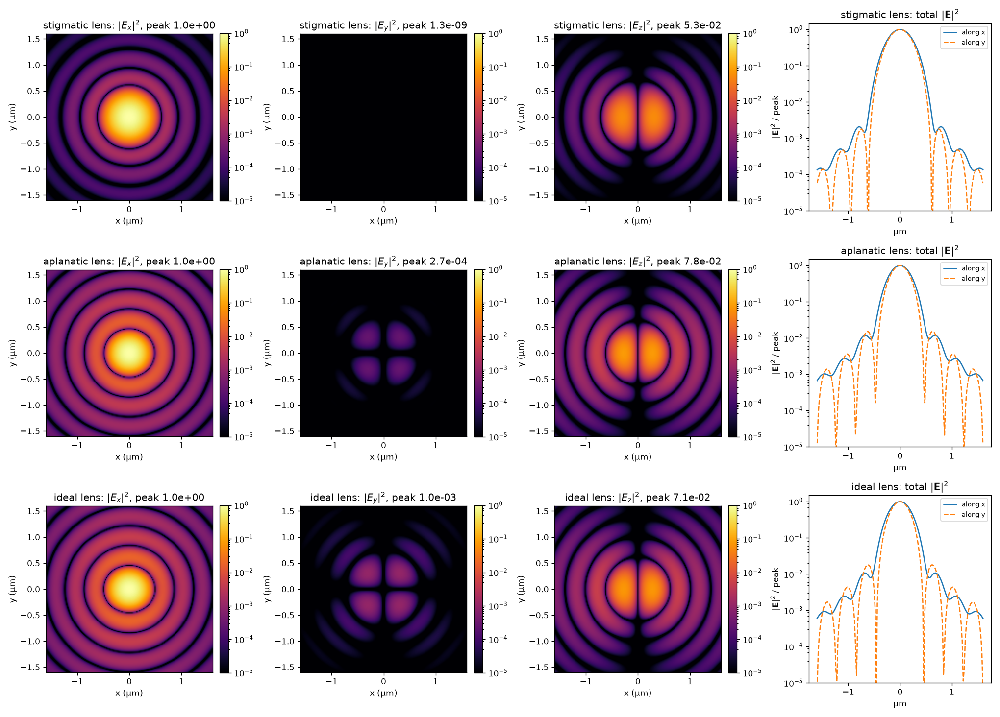
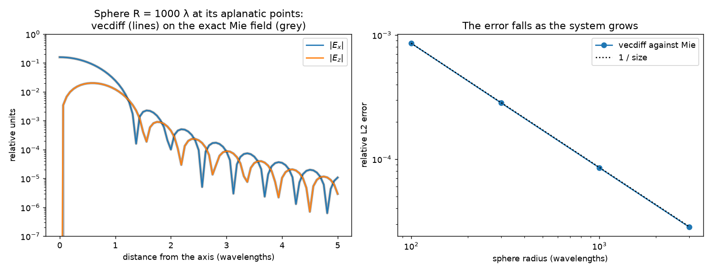

# vecdiff

**Vector diffraction through real optical systems.** vecdiff computes the
electromagnetic field, **E** and **H** with their polarization, of light
refracted, reflected and focused by lenses, mirrors and stops thousands of
wavelengths across: the regime where full-wave solvers cannot go and scalar
diffraction is not enough.

<p align="center">
  
</p>

<p align="center"><em>
A stigmatic glass lens at NA 0.7, 4.45 mm across (8400 wavelengths), computed
in 4 s on a laptop. Top: |E|² from the stop, through the glass, to the focus.
Bottom: the electric field in the plane of propagation around the focus. With
linear input the field off the axis turns in the x–z plane (ellipses: a spin
transverse to the direction of propagation); with radial input the focus is
polarized along the axis.
</em></p>

The method is eikonal–angular-spectrum transport. Across each surface the
field is carried along the rays of the light's own ray family, with the
Fresnel dyadic of the surface, the flux factor of the ray tube and its
caustic phase; between surfaces it is an exact superposition of plane waves.
It is the leading-order solution of Maxwell's equations in the size of the
system relative to the wavelength: nothing is added by hand, it is exact for
a plane wave on a plane interface, and its error falls as 1/size.

## What only the vector theory shows

All the figures of this section come from one script,
[`vector_focusing.py`](general/examples/vector_focusing.py), and start from one
lens, stigmatic but not aplanatic: an
ellipsoidal entry face that sends a collimated beam to a point inside the
glass (n = 1.5), and an exit sphere centred on that point. The marginal ray
meets the glass at 86° of incidence. Section 3 adds an aplanatic lens.

### 1. Refraction acts on the polarization

<p align="center">
  
</p>

The converging beam 1 mm before the focus, for linear x input. The surface
transmits p and s light differently (t<sub>p</sub> ≠ t<sub>s</sub>), and
bends the p component toward the axis, which creates E<sub>z</sub>. For a
collimated beam and one refraction the two effects compensate exactly,
t<sub>p</sub>/t<sub>s</sub> = 1/cos(θ<sub>i</sub> − θ<sub>t</sub>), so the
transverse field stays linear and round: the computed |E<sub>x</sub>| is the
same along x and along y, and E<sub>y</sub> is 3·10⁻⁶ of it in intensity.
None of this is imposed; it comes out of the Fresnel dyadic ray by ray. The
spike on the axis and the ripple at the rim are the diffraction of the stop.

### 2. The focus depends on the polarization

<p align="center">
  
</p>

The focal plane of the same lens for four inputs. Top: polarization ellipses
over the transverse intensity. Bottom: the longitudinal intensity
|E<sub>z</sub>|², on the same scale.

| Input | Transverse field | Longitudinal field |
|---|---|---|
| linear x | a spot polarized along x | two lobes along x, 5 % of the peak |
| circular | a spot, circular everywhere | a ring with a vortex on the axis, 3 % |
| radial | a ring with a polarization singularity | a spot **on the axis**, 74 % of the peak: the focus is longitudinal |
| azimuthal | a ring, field tangent to circles | exactly zero: a dark, purely transverse focus |

### 3. Even an aplanatic lens is not the ideal lens

<p align="center">
  
</p>

The textbook vector focus (Richards and Wolf) assumes an ideal lens: every
ray reaches the focus, at the angle of the sine condition, with no loss. A
real lens can meet the first two conditions exactly. The second row is such a
lens: two aspheric faces computed by the method of Wassermann and Wolf
(1949), the design principle of the single-lens objectives of optical discs.
Traced ray by ray it is stigmatic to 6·10⁻¹⁴ m and obeys the sine condition
to 5·10⁻¹². Same glass, same NA 0.7, linear x input:

| | stigmatic lens (ellipsoid) | aplanatic lens (two aspheres) | ideal lens |
|---|---|---|---|
| cross-polarized \|E<sub>y</sub>\|² / peak | 1·10⁻⁹ (none) | 2.7·10⁻⁴ | 1.0·10⁻³ |
| longitudinal \|E<sub>z</sub>\|² / peak | 5.3 % | 7.8 % | 7.1 % |
| \|E<sub>x</sub>\| at the focus, ideal lens = 1 | 0.82 | 0.95 | 1 |
| first side lobe / peak | 2·10⁻³ | 1·10⁻² | 1 to 2·10⁻² |

- **The aplanatic lens has the geometry of the ideal lens, and still a
  different focus.** What remains is the transmission of its two faces,
  which no ray design removes: at the rim they pass 99.8 % of the p light
  and 73 % of the s light. The pupil is therefore brighter along x than
  along y, the cross-polarized lobes are 3.7 times weaker than the ideal
  lens predicts, and the longitudinal field is relatively stronger. This
  polarization aberration belongs to the surfaces, not to the ray geometry.
- **A lens that is only stigmatic differs more.** The ellipsoid maps the
  pupil to angles differently from the sine condition, which apodizes the
  beam: a wider spot, lower side lobes, and no cross-polarized light at all.

### 4. Why to believe it

<p align="center">
  
</p>

- **Against the exact solution.** A glass sphere focuses without aberration
  a beam aimed at its aplanatic point (Young and Weierstrass), and it has an
  exact solution (Mie). The carried field lies on the exact one, and the
  error falls as 1/size:

  | sphere radius (wavelengths) | 100 | 300 | 1000 | 3000 |
  |---|---|---|---|---|
  | relative L2 error on the focal disk | 8.6·10⁻⁴ | 2.8·10⁻⁴ | 8.5·10⁻⁵ | 2.8·10⁻⁵ |

- **Against ray optics.** A Debye sum over traced rays with their Fresnel
  coefficients, written independently of the library, gives for the
  aplanatic lens |E<sub>x</sub>|, |E<sub>y</sub>|, |E<sub>z</sub>| maxima of
  7652.3, 125.4 and 2132.3 V/m; the library gives 7652.8, 125.2 and
  2132.6 V/m. For the ellipsoid, 6734.3 against 6735.0 V/m.
- **Against itself.** Every solution reports, per surface, the share of the
  light it did not carry and why, and refuses to return a field when folded,
  undersampled or band-limited light passes 1 %.

## The lens above, in code

<!-- fragment -->
```python
import numpy as np
import vecdiff as vd

air, glass = vd.media.air, vd.media.Dielectric(1.5, "glass")
entry = vd.surfaces.CartesianOval.from_conjugates(1.0, -np.inf, 1.5, 5e-3)
exit_face = vd.surfaces.SphericalCap(2.4e-3, vd.geometry.Frame([0, 0, 2.6e-3]))
lens = vd.system.OpticalSystem(
    vd.system.Stop(2.227e-3, z=-0.2e-3),
    vd.system.Refraction(entry, air, glass),
    vd.system.Refraction(exit_face, glass, air),
)
print(lens)

beam = vd.fields.PlaneBeam(
    vd.fields.profiles.Gaussian(4.45e-3),
    vd.fields.polarization.radial,  # or x, azimuthal, cartesian(1, 1j), ...
    wavelength0=532e-9,
    region=air,
    frame=vd.geometry.Frame([0, 0, -0.4e-3]),
)
solution = vd.propagation.Propagator(lens)(beam)  # 4 s
print(solution)  # per surface: what was not carried, and why

w = 1.6e-6
focal = solution.field(z=5e-3, window=(-w, w, -w, w), shape=(161, 161))
meridional = solution.field(y=0.0, window=(-w, w, 5e-3 - w, 5e-3 + w), shape=(161, 161))
S = vd.observables.poynting(focal)  # E and H are both there
```

```text
OpticalSystem: 3 elements, coaxial along z; light arrives in air (n 1) and leaves in air (n 1)
#  element     surface  type                 z      radius  medium        n         aperture r  thickness
-  ----------  -------  -------------  -------  ----------  ------------  --------  ----------  ---------
1  Stop                 screen         -0.0002              air           1         0.00222687     0.0002
2  Refraction  S1       CartesianOval   0       0.00166667  air -> glass  1 -> 1.5                 0.0026
3  Refraction  S2       SphericalCap    0.0026  0.0024      glass -> air  1.5 -> 1
R > 0: centre of curvature toward +z; thickness: axial distance to the next vertex; unit of wavelength0.
```

## What it can do

| | |
|---|---|
| **Systems** | An ordered path of `Refraction`, `Reflection` and `Stop`: lenses, ideal and metallic mirrors, Fresnel reflections, ghost paths that meet a surface again. Spheres, conics and even aspheres, Cartesian ovals, cylinders, freeform graphs. `print(system)` gives the prescription table. |
| **Light** | Collimated and focused beams from a scalar profile (uniform, Gaussian, annular, zoned) and a polarization (linear, circular, elliptical, radial, azimuthal, or any Jones pair); sampled fields on a plane. |
| **Fields** | E and H in V/m and A/m on planes, meridional sections, surfaces or arbitrary points, in any segment of the system. |
| **Observables** | Poynting vector, irradiance, power, energy density, Stokes parameters, spin and helicity, canonical and spin momentum, orbital angular momentum, radiation force and torque. |
| **Honesty of a result** | Every solution reports, per surface, the share of the light it did not carry and why (outside the aperture, folded rays, undersampling), counts the caustics crossed, and refuses to return a field when folded, undersampled or band-limited light passes 1 %. |
| **Checks** | Exact solutions to compare with (Mie sphere, layered sphere, infinite cylinder, with their Debye terms), a second, independent method (wave transport), and a separate package of full-wave solvers (BEM, FEM, MFS). 700 tests. |
| **Matter** | Real indices throughout; a complex index (metals, lossy glass) for reflection and for propagation inside a homogeneous region ([note](docs/ABSORBING_MEDIA.md)). |

It does not yet carry light along rays *through* an absorbing medium, and it
does not model dispersion within one calculation, coatings, partial
coherence, the evanescent near field of a surface or the rim scattering of a
finite body. It computes fields; analysis outputs (PSF, MTF, Strehl ratio,
Zernike or OPD maps, focus search) are not part of it yet.

## Quick start

A collimated Gaussian beam through a plano-convex lens, flat side first, and
E, H and the Poynting vector at its focus:

```python
import numpy as np
import vecdiff as vd

# The system: what the light meets, in order. Lengths in metres here; any
# unit works if the wavelength is given in it.
air, glass = vd.media.air, vd.media.Dielectric(1.5, "glass")
curved = vd.surfaces.SphericalCap(-25e-3, vd.geometry.Frame([0, 0, 3e-3]))
lens = vd.system.OpticalSystem(
    vd.system.Stop(4e-3, z=-0.5e-3),  # an opaque screen with a 4 mm hole
    vd.system.Refraction(vd.surfaces.Plane.z(0.0), air, glass),
    vd.system.Refraction(curved, glass, air),
)

# The light: 2 mm waist, polarized along x, 532 nm, its plane 1 mm before the lens.
beam = vd.fields.PlaneBeam(
    vd.fields.profiles.Gaussian(2e-3),
    vd.fields.polarization.x,
    wavelength0=532e-9,
    region=air,
    frame=vd.geometry.Frame([0, 0, -1e-3]),
)

solution = vd.propagation.Propagator(lens)(beam)
print(solution)  # per element: what it did not carry, and why

# E and H on the plane of best focus, over a 40 um square.
focus = solution.field(
    z=52.7e-3, window=(-20e-6, 20e-6, -20e-6, 20e-6), shape=(81, 81)
)
S = vd.observables.poynting(focus)  # time-averaged, W/m²
centre = (40, 40)
print("E (V/m):", np.round(focus.electric.values[centre], 2))
print("H (A/m):", np.round(focus.magnetic[centre], 4))
print("S (W/m²):", np.round(S[centre], 3))
print(f"power through the square: {vd.observables.power(focus):.3e} W")
```

It runs in about 8 s and 1.6 GB on a laptop CPU and prints (measured now):

```text
Solution: light through 3 elements, 3 carried
#  element     surface       media         leg       unsupported %  folded %  undersampled %  band removed %  dark  caustics  residual  orders
-  ----------  ------------  ------------  --------  -------------  --------  --------------  --------------  ----  --------  --------  -------
1  Stop        r 0.004       air           meridian          1.8           0               0               0     0         0   0        (-1, 1)
2  Refraction  Plane         air -> glass  meridian          0.072         0               0               0     0         0   0        (-1, 1)
3  Refraction  SphericalCap  glass -> air  meridian          0.083         0               0               0     0         0   4.3e-19  (-1, 1)
Leaves as HankelSpectrum in 'air', plane z=0.003, forward (+normal).
...
E (V/m): [-18.64+337.96j   0.    +0.j     0.    +0.j  ]
H (A/m): [ 0.    -0.j     -0.0495+0.8971j  0.    +0.j    ]
S (W/m²): [  0.      0.    152.053]
power through the square: 7.525e-09 W
```

- **The report.** The stop holds back 1.8 % of the incident amplitude, the
  Gaussian's tail beyond 4 mm (exp(−(4/2)²) = 0.018).
- **The focus.** Paraxially it lies f = R/(n − 1) = 50 mm behind the curved
  vertex, at z = 53 mm; spherical aberration of the flat-first lens brings the
  axial maximum to 52.7 mm (the axis scan in
  [`plano_convex_lens.py`](general/examples/plano_convex_lens.py) finds it).
  A scalar diffraction integral over the traced wavefront gives |E| = 339 V/m
  there with t = 0.96, against 338 V/m above; an unaberrated lens would give
  π w² t / (λ f) = 454 V/m.
- **Units.** E is in V/m (the beam's profile is 1 V/m at its centre), H in
  A/m, S in W/m². Powers are in watts because the lengths are in metres.

## Install

Python 3.10 or newer. The library is pure Python; NumPy and SciPy are its
only dependencies:

```sh
python3 -m venv .venv
.venv/bin/python -m pip install -e './general[test,notebooks,nufft]'
```

`nufft` installs FINUFFT, which the transport uses for its plane-wave sums
when it is present (strongly recommended); `notebooks` installs Matplotlib and
the Jupyter execution tools; `cuda12` or `cuda13` installs CuPy for a CUDA
GPU ([GPU backend](#gpu-backend)). `requirements-dev.lock` records the
qualified development environment; the root `pyproject.toml` configures code
style.

The independent full-wave solvers that validate the library (BEM, FEM, MFS,
meshing) are a separate package, `vecdiff_validation` in `validation/`. It
builds a Fortran extension and needs a C and a Fortran compiler (tested with
gfortran); the library never imports it. To run the whole test suite:

```sh
.venv/bin/python -m pip install meson-python ninja 'numpy>=2'
.venv/bin/python -m pip install --no-build-isolation './validation[test,mesh]'
.venv/bin/python -m pip install -e './stigmatic[test,notebooks,nufft]' ruff
.venv/bin/python -m pytest -q
.venv/bin/ruff check .
.venv/bin/ruff format --check .
```

## The library, in the order of its ontology

Public objects are reached through the namespace of what they are
(`vd.system.Refraction`, `vd.propagation.Propagator`); the package top level
re-exports nothing.

| Namespace | What it is |
|---|---|
| `geometry`, `media`, `surfaces`, `volumes` | Space and matter: frames; materials (`Dielectric`, the absorbing `Medium`, `air`, `vacuum`) and the regions they fill; surfaces (caps, aspheres, ovals, freeforms, closed bodies); volumes for the references |
| `system` | The optical system: the ordered path of `Refraction`, `Reflection` and `Stop` the light meets |
| `fields` | Light: beams (`PlaneBeam`, `FocusedBeam`) from a profile and a polarization, sampled fields, the carrier, and `Spectrum`, the plane-wave field of a region |
| `transport` | The method across one surface: the ray map and its caustic index, the dyadics, the leg on a lattice or on a meridian, its report |
| `propagation` | The method through the whole system: `Propagator(system)(light)` returns a `Solution`, with E and H on any target; plane waves between surfaces |
| `observables` | What is measured on a field: Poynting vector, irradiance, power, energy, Stokes parameters, spin, helicity, momenta, forces |
| `references` | Exact solutions to check against: `MieSphere`, `LayeredSphere`, `InfiniteCylinder`, with their Debye terms |
| `alternatives` | Other methods, for checks: wave transport (`WavePropagator`, `SurfaceTransport`, `SpectralFresnel`, `LocalFresnel`) and the exact planar boundary |
| `fourier`, `sampling`, `backend` | Numerical infrastructure: transforms, grids, the CPU/CUDA switch |
| `visualization`, `io`, `catalog` | Tools: plots, JSON prescriptions, catalog lenses |

`visualization` and `references` are imported explicitly, so importing the
package loads neither plotting nor the reference solvers.

## Documentation and examples

- [The method](docs/PROPAGATION.md): the system as a path, the transport leg,
  its two realizations, sequences, reports, results, exact references and the
  regression record; other methods last.
- [Architecture](docs/ARCHITECTURE.md): responsibilities, units and source map.
- [Validation](docs/VALIDATION.md): how the method and the other methods are
  checked, and the measured records.
- [Fourier transforms and grids](docs/FOURIER_AND_GRIDS.md): Cartesian, polar and
  nonuniform transforms with physical coordinates.
- [Absorbing media](docs/ABSORBING_MEDIA.md): what a complex index changes, what is exact, and what is not yet carried.
- [Notebooks](docs/NOTEBOOKS.md): eight executed optical studies.
- [Changes](docs/CHANGES.md): what changed for a reader of the earlier API.
- [Roadmap](ROADMAP.md): planned validation, performance and modeling work.

Runnable scripts in [`general/examples/`](general/examples/), each under
a minute on a laptop; each prints a few numbers with what to expect and why:

| Script | Shows |
|---|---|
| [`vector_focusing.py`](general/examples/vector_focusing.py) | A stigmatic and an aplanatic lens at NA 0.7 with four input polarizations, against the ideal lens, ray optics and Mie: the figures of this page |
| [`two_lens_polarization.py`](general/examples/two_lens_polarization.py) | A stop and two spherical lenses: the field through the whole system and its aberrated focus |
| [`printing.py`](general/examples/printing.py) | What `print` shows for systems, beams, fields and solutions |
| [`plano_convex_lens.py`](general/examples/plano_convex_lens.py) | The quick start with an axis scan for the focus and automatic focal-plane sampling |
| [`paraboloidal_mirror.py`](general/examples/paraboloidal_mirror.py) | An ideal mirror: the light comes back, its axis turned over |
| [`plate_ghost.py`](general/examples/plate_ghost.py) | A ghost path built from the same two surfaces as the direct light |
| [`beams_and_pupils.py`](general/examples/beams_and_pupils.py) | `fields`: profiles, polarizations, zoned pupils, against Rayleigh, Airy and symmetry |
| [`one_transport_leg.py`](general/examples/one_transport_leg.py) | `transport`: the ray map, a lattice leg, its report and a caustic inside the leg |
| [`exact_references.py`](general/examples/exact_references.py) | `references`: Mie, layered sphere, cylinder, Debye terms |
| [`observables_of_light.py`](general/examples/observables_of_light.py) | `observables`: power, irradiance, Stokes, spin, momenta, radiation force |
| [`wave_transport.py`](general/examples/wave_transport.py) | `alternatives.WavePropagator`, the other method, on a sampled field |

## Physical contracts

- Lengths are in one unit, that of the vacuum wavelength `wavelength0`. E and H are phasors in V/m and A/m, so S is in W/m²; quantities that integrate over area or involve the frequency (power, momentum, spin, force) are SI when lengths are metres. Time dependence is `exp(-i omega t)`.
- `ElectricField(grid, wavelength0, values)` owns electric samples, with `Ex`, `Ey`, `Ez` views and `norm2()` (|E|², electric amplitude squared, not an irradiance). `ElectromagneticField` holds E and H on one grid; its `poynting()`, `irradiance()` and `power()` preserve coherent interference.
- `Grid` owns physical coordinates, placement, and any integration measure. `CartesianGrid` (alias `PlaneGrid`) components use a declared right-handed frame; E values are global Cartesian vectors.
- A beam (`fields.PlaneBeam`, `fields.FocusedBeam`) is a source-free sum of propagating plane waves in one medium. It takes a scalar `profile` from `fields.profiles` (`Uniform`, `Gaussian`, `Annulus`, `Zones`, and their products) and a separate `polarization` from `fields.polarization` (`x`, `y`, `radial`, `azimuthal`, or any Cartesian or polar pair), evaluates anywhere through a quadrature chosen for the evaluation region, and declares its rays as a `fields.Carrier`.
- `TransverseElectricField` prescribes two local plane components; the longitudinal one follows from the medium. A complete electric vector is validated, never silently projected.
- A medium (`media.Dielectric`) is what fills space; a region (`media.HomogeneousRegion`) is a part of space with its medium. The system derives its regions from its path; the references take regions.
- Momentum observables use the dual-symmetric densities of Berry and Bliokh–Bekshaev–Nori: `observables.spin_density` and `helicity_density` read E/H samples; `canonical_momentum`, `spin_momentum` and `orbital_angular_momentum` read an `ElectricFieldJet` (`observables.plane_wave_jet(expansion, grid)`), with ε μ P = p_o + ∇×S/2. `observables.force` and `torque` integrate the Maxwell stress tensor over a closed surface quadrature.

## GPU backend

One global switch moves arrays and computation to a CUDA GPU. Make it at the
top of a script, before building any vecdiff object:

<!-- fragment -->
```python
from vecdiff import backend

backend.set_backend("CUDA")  # "CPU" is the default; needs CuPy and a CUDA device
```

Everything built and computed afterwards lives on the GPU, in double precision;
results match the CPU to roundoff. NumPy arrays and lists passed in are moved to
the device on entry, results stay there until `backend.to_numpy(array)`, and
plotting converts on its own. Objects built before a switch keep their arrays on
the old device and must be rebuilt. Geometry, meshing, the reference solvers in
`references` and FINUFFT compute on the CPU; their inputs and results
are moved for them. `backend.bd` is the current array module (NumPy or CuPy) for
creating arrays on the same device. `VECDIFF_BACKEND=CUDA pytest general/tests`
runs the test suite on the GPU.

The gain depends on the operation. Measured when the backend was added, on a
laptop RTX 4060 (8 GB) against 16 CPU threads: focal maps of a `FocusedBeam`
about 14× faster, angular-spectrum propagation of a 2048² field 10×, an
order-1 Hankel transform 37× and the curved-surface transfer `SurfaceTransport`
6–9×, all matching the CPU to roundoff. Device memory bounds the lattice:
angular-spectrum propagation holds about 3 GB at 2048². FINUFFT stays on the
CPU: in double precision it outpaces cuFINUFFT on consumer cards.

More studies, with their figures, are in the executed [notebooks](docs/NOTEBOOKS.md).

## License

Original project code and documentation are licensed under the [Apache License 2.0](LICENSE).
Third-party code, publications, datasets, fonts, and other assets retain their
respective licenses and copyright notices; this license does not replace them.
