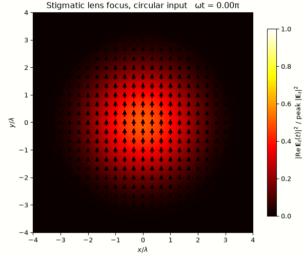
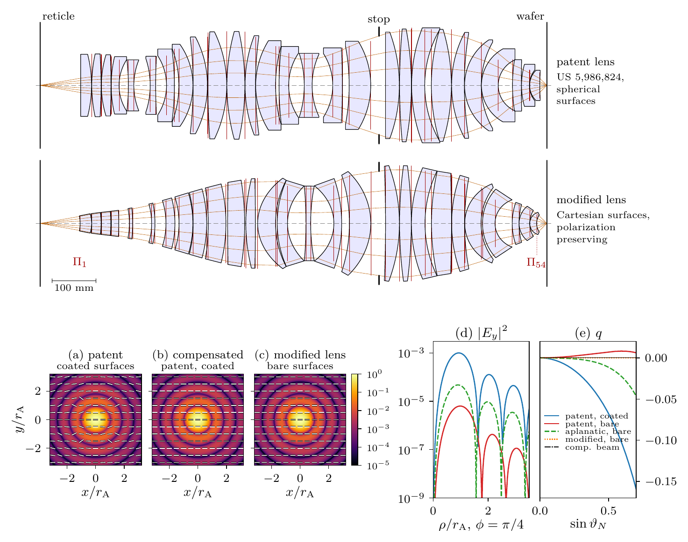
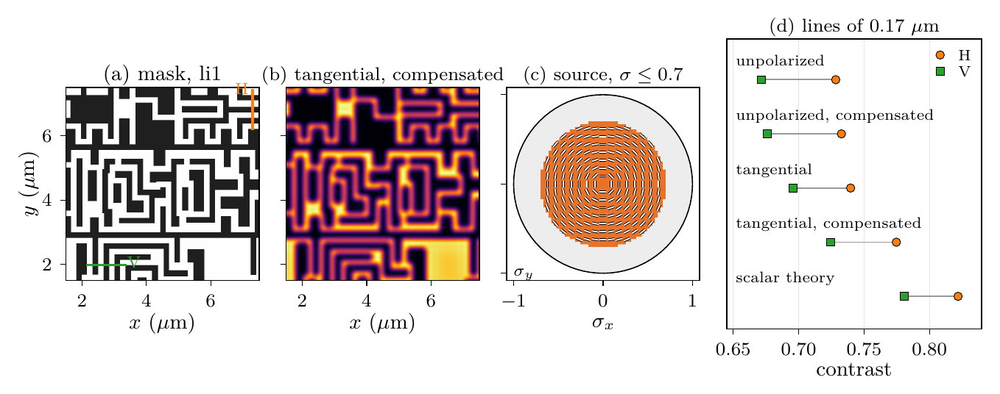
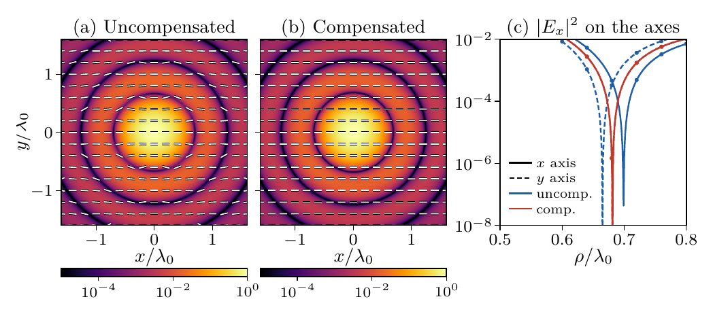
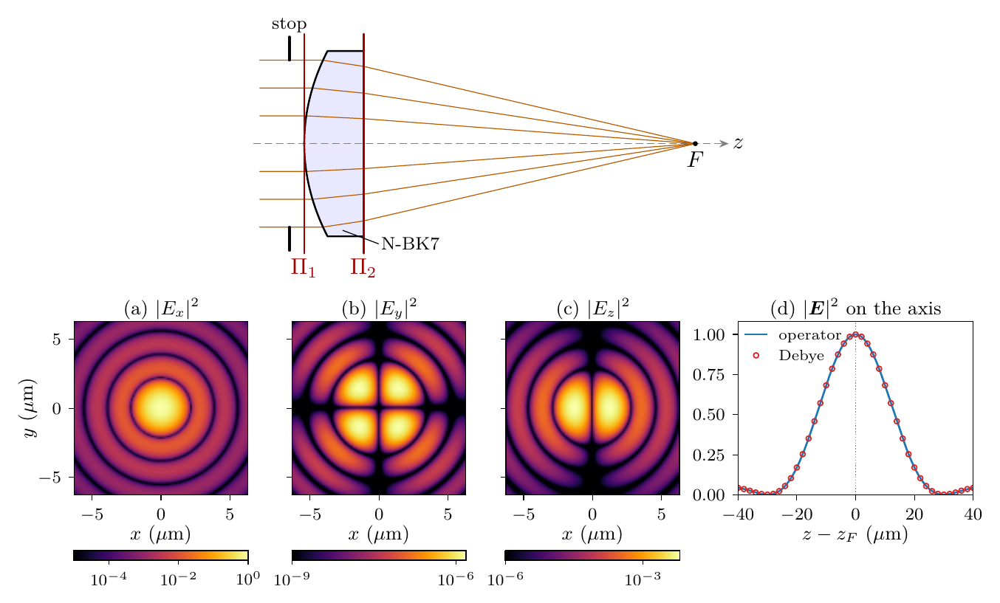
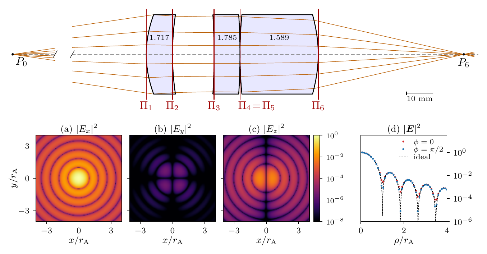
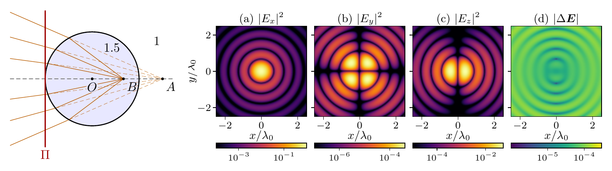

# vecdiff

vecdiff is a Python library for vector diffraction through optical systems.
It computes the electromagnetic field, **E** and **H** with their
polarization, of light refracted, reflected and focused by lenses, mirrors
and stops thousands of wavelengths across.

<p align="center">
  
  
</p>

<p align="center"><em>
Instantaneous focal field Re[E e<sup>−iωt</sup>] of a stigmatic lens over the
optical cycle: arrows show the transverse field over its time-averaged
intensity. Linear x input (left) oscillates; circular input (right) rotates.
</em></p>

**Method.** Eikonal–angular-spectrum transport: across each surface the field
is carried along the rays of the light, with the Fresnel dyadic of the
surface, the flux factor of the ray tube and its caustic phase; between
surfaces it is an exact superposition of plane waves. The error falls as the
inverse of the size of the system in wavelengths
([the method](docs/PROPAGATION.md)).

## Applications

### Projection lens for deep-ultraviolet lithography

<p align="center">
  
</p>

A 27-element projection lens (US 5,986,824, first embodiment): 54 surfaces,
NA 0.70 on the wafer, 248.4 nm, 1160 mm from reticle to wafer. Top: the
patent lens and a lens modified with Cartesian surfaces to preserve the
polarization. Bottom: focal field of the axial point for a source polarized
along x, (a) for the coated patent lens, (b) for the same lens with its
compensating beam, (c) for the modified lens; (d) cross-polarized intensity;
(e) vectorial aberration q across the pupil. With the compensating beam and with
the modified lens the cross-polarized component lies below the range shown.

<p align="center">
  
</p>

Image of a circuit layout through the same lens, with partial coherence 0.7:
(a) the mask, (b) the image under tangentially polarized illumination with
the compensating beam, (c) the source, (d) contrast of the 0.17 µm lines for
each illumination, with and without the compensating beam.

### Compensating beam

<p align="center">
  
</p>

Focus of an aplanatic sphere (n = 1.5, radius 1000 λ<sub>0</sub>, NA 0.9).
(a) A beam polarized along x: the first dark ring is an ellipse and the focus
has a cross-polarized component of 4·10⁻⁴ of the peak. (b) The compensating
beam of the sphere: the transverse field is polarized along x, and the
cross-polarized component falls to 4·10⁻¹⁰. (c) Lines: vecdiff; dots: the
exact field (Mie).

### Commercial aspheric lens

<p align="center">
  
</p>

Thorlabs AL1225 (N-BK7, focal length 25 mm, NA 0.23) at 780 nm, 14 400
wavelengths across. (a)–(c) The three Cartesian components on the focal
plane; (d) intensity along the axis, against a Debye integral over the
traced rays.

### Lens of Cartesian surfaces

<p align="center">
  
</p>

An aplanatic lens of three elements and six Cartesian surfaces, NA 0.22 on
the image side, 5·10⁴ wavelengths across at 587.6 nm. (a)–(c) Field
components on the image plane; (d) intensity against the ideal aplanatic
focus.

These systems are from J. Blanco, *Tangent-plane transmission operator for
the propagation of vector fields through smooth refracting surfaces*
(manuscript in preparation). The sphere and the two single lenses were
computed with vecdiff. The projection lens was computed with a direct
implementation of the same chain of surface operators for systems of
revolution; vecdiff's `Propagator` gives the same fields to 10⁻⁵ on reduced
copies of the lens.

## Features

| | |
|---|---|
| **Systems** | An ordered path of `Refraction`, `Reflection` and `Stop`: lenses, ideal and metallic mirrors, Fresnel reflections, ghost paths that meet a surface again. Spheres, conics and even aspheres, Cartesian ovals, cylinders, freeform graphs. `print(system)` gives the prescription table. |
| **Light** | Collimated and focused beams from a scalar profile (uniform, Gaussian, annular, zoned) and a polarization (linear, circular, elliptical, radial, azimuthal, or any Jones pair); sampled fields on a plane. |
| **Fields** | E and H in V/m and A/m on planes, meridional sections, surfaces or arbitrary points, in any segment of the system. |
| **Observables** | Poynting vector, irradiance, power, energy density, Stokes parameters, spin and helicity, canonical and spin momentum, orbital angular momentum, radiation force and torque. |
| **Diagnostics** | Every solution reports, per surface, the share of the light it did not carry and why (outside the aperture, folded rays, undersampling), counts the caustics crossed, and refuses to return a field when folded, undersampled or band-limited light passes 1 %. |
| **Checks** | Exact solutions to compare with (Mie sphere, layered sphere, infinite cylinder, with their Debye terms), a second, independent method (wave transport), and a separate package of full-wave solvers (BEM, FEM, MFS). 700 tests. |
| **Matter** | Real indices throughout; a complex index (metals, lossy glass) for reflection and for propagation inside a homogeneous region ([note](docs/ABSORBING_MEDIA.md)). |

It does not yet carry light along rays *through* an absorbing medium, and it
does not model dispersion within one calculation, coatings, partial
coherence, the evanescent near field of a surface or the rim scattering of a
finite body. It computes fields; analysis outputs (PSF, MTF, Strehl ratio,
Zernike or OPD maps, focus search) are not part of it yet.

## Quick start

A collimated Gaussian beam through a plano-convex lens, flat side first, and
E, H and the Poynting vector at its focus:

```python
import numpy as np
import vecdiff as vd

# The system: what the light meets, in order. Lengths in metres here; any
# unit works if the wavelength is given in it.
air, glass = vd.media.air, vd.media.Dielectric(1.5, "glass")
curved = vd.surfaces.SphericalCap(-25e-3, vd.geometry.Frame([0, 0, 3e-3]))
lens = vd.system.OpticalSystem(
    vd.system.Stop(4e-3, z=-0.5e-3),  # an opaque screen with a 4 mm hole
    vd.system.Refraction(vd.surfaces.Plane.z(0.0), air, glass),
    vd.system.Refraction(curved, glass, air),
)

# The light: 2 mm waist, polarized along x, 532 nm, its plane 1 mm before the lens.
beam = vd.fields.PlaneBeam(
    vd.fields.profiles.Gaussian(2e-3),
    vd.fields.polarization.x,
    wavelength0=532e-9,
    region=air,
    frame=vd.geometry.Frame([0, 0, -1e-3]),
)

solution = vd.propagation.Propagator(lens)(beam)
print(solution)  # per element: what it did not carry, and why

# E and H on the plane of best focus, over a 40 um square.
focus = solution.field(
    z=52.7e-3, window=(-20e-6, 20e-6, -20e-6, 20e-6), shape=(81, 81)
)
S = vd.observables.poynting(focus)  # time-averaged, W/m²
centre = (40, 40)
print("E (V/m):", np.round(focus.electric.values[centre], 2))
print("H (A/m):", np.round(focus.magnetic[centre], 4))
print("S (W/m²):", np.round(S[centre], 3))
print(f"power through the square: {vd.observables.power(focus):.3e} W")
```

It runs in about 8 s and 1.6 GB on a laptop CPU and prints (measured now):

```text
Solution: light through 3 elements, 3 carried
#  element     surface       media         leg       unsupported %  folded %  undersampled %  band removed %  dark  caustics  residual  orders
-  ----------  ------------  ------------  --------  -------------  --------  --------------  --------------  ----  --------  --------  -------
1  Stop        r 0.004       air           meridian          1.8           0               0               0     0         0   0        (-1, 1)
2  Refraction  Plane         air -> glass  meridian          0.072         0               0               0     0         0   0        (-1, 1)
3  Refraction  SphericalCap  glass -> air  meridian          0.083         0               0               0     0         0   4.3e-19  (-1, 1)
Leaves as HankelSpectrum in 'air', plane z=0.003, forward (+normal).
...
E (V/m): [-18.64+337.96j   0.    +0.j     0.    +0.j  ]
H (A/m): [ 0.    -0.j     -0.0495+0.8971j  0.    +0.j    ]
S (W/m²): [  0.      0.    152.053]
power through the square: 7.525e-09 W
```

E is in V/m (the beam's profile is 1 V/m at its centre), H in A/m and S in
W/m²; powers are in watts because the lengths are in metres.

## Validation

<p align="center">
  
</p>

Field at the aplanatic point of a glass sphere of radius 1000 λ<sub>0</sub>
(NA 0.9): (a)–(c) the three components, (d) the difference from the exact
solution (Mie series, first transmitted Debye term), relative to the peak
field. The relative L2 difference is 0.06 % over the window shown, and it is
inversely proportional to the radius of the sphere.

The library includes the exact solutions it is checked against (`MieSphere`,
`LayeredSphere`, `InfiniteCylinder`) and a second, independent method (wave
transport). Full-wave solvers (BEM, FEM, MFS) are in the separate
`validation/` package. Methods, records and limits:
[validation](docs/VALIDATION.md).

## Install

Python 3.10 or newer. The library is pure Python; NumPy and SciPy are its
only dependencies:

```sh
python3 -m venv .venv
.venv/bin/python -m pip install -e './general[test,notebooks,nufft]'
```

`nufft` installs FINUFFT, which the transport uses for its plane-wave sums
when it is present (strongly recommended); `notebooks` installs Matplotlib and
the Jupyter execution tools; `cuda12` or `cuda13` installs CuPy for a CUDA
GPU ([GPU backend](#gpu-backend)). `requirements-dev.lock` records the
qualified development environment; the root `pyproject.toml` configures code
style.

The independent full-wave solvers that validate the library (BEM, FEM, MFS,
meshing) are a separate package, `vecdiff_validation` in `validation/`. It
builds a Fortran extension and needs a C and a Fortran compiler (tested with
gfortran); the library never imports it. The earlier stigmatic library,
`vecdiff_stigmatic`, lives in its own repository; three cross-library checks
in `validation/` run when it is installed and are skipped otherwise. To run
the whole test suite:

```sh
.venv/bin/python -m pip install meson-python ninja 'numpy>=2'
.venv/bin/python -m pip install --no-build-isolation './validation[test,mesh]'
.venv/bin/python -m pip install ruff
.venv/bin/python -m pytest -q
.venv/bin/ruff check .
.venv/bin/ruff format --check .
```

## Package layout

Public objects are reached through the namespace of what they are
(`vd.system.Refraction`, `vd.propagation.Propagator`); the package top level
re-exports nothing.

| Namespace | What it is |
|---|---|
| `geometry`, `media`, `surfaces`, `volumes` | Space and matter: frames; materials (`Dielectric`, the absorbing `Medium`, `air`, `vacuum`) and the regions they fill; surfaces (caps, aspheres, ovals, freeforms, closed bodies); volumes for the references |
| `system` | The optical system: the ordered path of `Refraction`, `Reflection` and `Stop` the light meets |
| `fields` | Light: beams (`PlaneBeam`, `FocusedBeam`) from a profile and a polarization, sampled fields, the carrier, and `Spectrum`, the plane-wave field of a region |
| `transport` | The method across one surface: the ray map and its caustic index, the dyadics, the leg on a lattice or on a meridian, its report |
| `propagation` | The method through the whole system: `Propagator(system)(light)` returns a `Solution`, with E and H on any target; plane waves between surfaces |
| `observables` | What is measured on a field: Poynting vector, irradiance, power, energy, Stokes parameters, spin, helicity, momenta, forces |
| `references` | Exact solutions to check against: `MieSphere`, `LayeredSphere`, `InfiniteCylinder`, with their Debye terms |
| `alternatives` | Other methods, for checks: wave transport (`WavePropagator`, `SurfaceTransport`, `SpectralFresnel`, `LocalFresnel`) and the exact planar boundary |
| `fourier`, `sampling`, `backend` | Numerical infrastructure: transforms, grids, the CPU/CUDA switch |
| `visualization`, `io`, `catalog` | Tools: plots, JSON prescriptions, catalog lenses |

`visualization` and `references` are imported explicitly, so importing the
package loads neither plotting nor the reference solvers.

## Documentation and examples

- [The method](docs/PROPAGATION.md): the system as a path, the transport leg,
  its two realizations, sequences, reports, results, exact references and the
  regression record; other methods last.
- [Architecture](docs/ARCHITECTURE.md): responsibilities, units and source map.
- [Validation](docs/VALIDATION.md): how the method and the other methods are
  checked, and the measured records.
- [Fourier transforms and grids](docs/FOURIER_AND_GRIDS.md): Cartesian, polar and
  nonuniform transforms with physical coordinates.
- [Absorbing media](docs/ABSORBING_MEDIA.md): what a complex index changes, what is exact, and what is not yet carried.
- [Notebooks](docs/NOTEBOOKS.md): eight executed optical studies.
- [Changes](docs/CHANGES.md): what changed for a reader of the earlier API.
- [Roadmap](ROADMAP.md): planned validation, performance and modeling work.

Runnable scripts in [`general/examples/`](general/examples/), each under
a minute on a laptop; each prints a few numbers with what to expect and why:

| Script | Shows |
|---|---|
| [`vector_focusing.py`](general/examples/vector_focusing.py) | A stigmatic and an aplanatic lens at NA 0.7 with four input polarizations, against the ideal lens, ray optics and Mie |
| [`two_lens_polarization.py`](general/examples/two_lens_polarization.py) | A stop and two spherical lenses: the field through the whole system and its aberrated focus |
| [`printing.py`](general/examples/printing.py) | What `print` shows for systems, beams, fields and solutions |
| [`plano_convex_lens.py`](general/examples/plano_convex_lens.py) | The quick start with an axis scan for the focus and automatic focal-plane sampling |
| [`paraboloidal_mirror.py`](general/examples/paraboloidal_mirror.py) | An ideal mirror: the light comes back, its axis turned over |
| [`plate_ghost.py`](general/examples/plate_ghost.py) | A ghost path built from the same two surfaces as the direct light |
| [`beams_and_pupils.py`](general/examples/beams_and_pupils.py) | `fields`: profiles, polarizations, zoned pupils, against Rayleigh, Airy and symmetry |
| [`one_transport_leg.py`](general/examples/one_transport_leg.py) | `transport`: the ray map, a lattice leg, its report and a caustic inside the leg |
| [`exact_references.py`](general/examples/exact_references.py) | `references`: Mie, layered sphere, cylinder, Debye terms |
| [`observables_of_light.py`](general/examples/observables_of_light.py) | `observables`: power, irradiance, Stokes, spin, momenta, radiation force |
| [`wave_transport.py`](general/examples/wave_transport.py) | `alternatives.WavePropagator`, the other method, on a sampled field |

## Conventions

- Lengths are in one unit, that of the vacuum wavelength `wavelength0`. E and H are phasors in V/m and A/m, so S is in W/m²; quantities that integrate over area or involve the frequency (power, momentum, spin, force) are SI when lengths are metres. Time dependence is `exp(-i omega t)`.
- `ElectricField(grid, wavelength0, values)` owns electric samples, with `Ex`, `Ey`, `Ez` views and `norm2()` (|E|², electric amplitude squared, not an irradiance). `ElectromagneticField` holds E and H on one grid; its `poynting()`, `irradiance()` and `power()` preserve coherent interference.
- `Grid` owns physical coordinates, placement, and any integration measure. `CartesianGrid` (alias `PlaneGrid`) components use a declared right-handed frame; E values are global Cartesian vectors.
- A beam (`fields.PlaneBeam`, `fields.FocusedBeam`) is a source-free sum of propagating plane waves in one medium. It takes a scalar `profile` from `fields.profiles` (`Uniform`, `Gaussian`, `Annulus`, `Zones`, and their products) and a separate `polarization` from `fields.polarization` (`x`, `y`, `radial`, `azimuthal`, or any Cartesian or polar pair), evaluates anywhere through a quadrature chosen for the evaluation region, and declares its rays as a `fields.Carrier`.
- `TransverseElectricField` prescribes two local plane components; the longitudinal one follows from the medium. A complete electric vector is validated, never silently projected.
- A medium (`media.Dielectric`) is what fills space; a region (`media.HomogeneousRegion`) is a part of space with its medium. The system derives its regions from its path; the references take regions.
- Momentum observables use the dual-symmetric densities of Berry and Bliokh–Bekshaev–Nori: `observables.spin_density` and `helicity_density` read E/H samples; `canonical_momentum`, `spin_momentum` and `orbital_angular_momentum` read an `ElectricFieldJet` (`observables.plane_wave_jet(expansion, grid)`), with ε μ P = p_o + ∇×S/2. `observables.force` and `torque` integrate the Maxwell stress tensor over a closed surface quadrature.

## GPU backend

One global switch moves arrays and computation to a CUDA GPU. Make it at the
top of a script, before building any vecdiff object:

<!-- fragment -->
```python
from vecdiff import backend

backend.set_backend("CUDA")  # "CPU" is the default; needs CuPy and a CUDA device
```

Everything built and computed afterwards lives on the GPU, in double precision;
results match the CPU to roundoff. NumPy arrays and lists passed in are moved to
the device on entry, results stay there until `backend.to_numpy(array)`, and
plotting converts on its own. Objects built before a switch keep their arrays on
the old device and must be rebuilt. Geometry, meshing, the reference solvers in
`references` and FINUFFT compute on the CPU; their inputs and results
are moved for them. `backend.bd` is the current array module (NumPy or CuPy) for
creating arrays on the same device. `VECDIFF_BACKEND=CUDA pytest general/tests`
runs the test suite on the GPU.

The gain depends on the operation. Measured when the backend was added, on a
laptop RTX 4060 (8 GB) against 16 CPU threads: focal maps of a `FocusedBeam`
about 14× faster, angular-spectrum propagation of a 2048² field 10×, an
order-1 Hankel transform 37× and the curved-surface transfer `SurfaceTransport`
6–9×, all matching the CPU to roundoff. Device memory bounds the lattice:
angular-spectrum propagation holds about 3 GB at 2048². FINUFFT stays on the
CPU: in double precision it outpaces cuFINUFFT on consumer cards.

## License

Original project code and documentation are licensed under the [Apache License 2.0](LICENSE).
Third-party code, publications, datasets, fonts, and other assets retain their
respective licenses and copyright notices; this license does not replace them.
