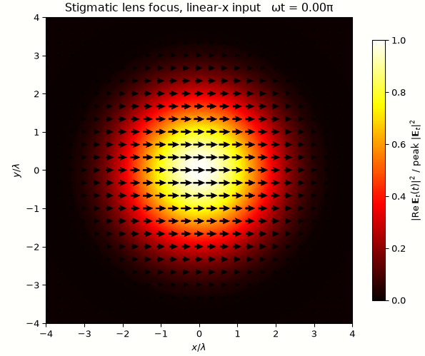
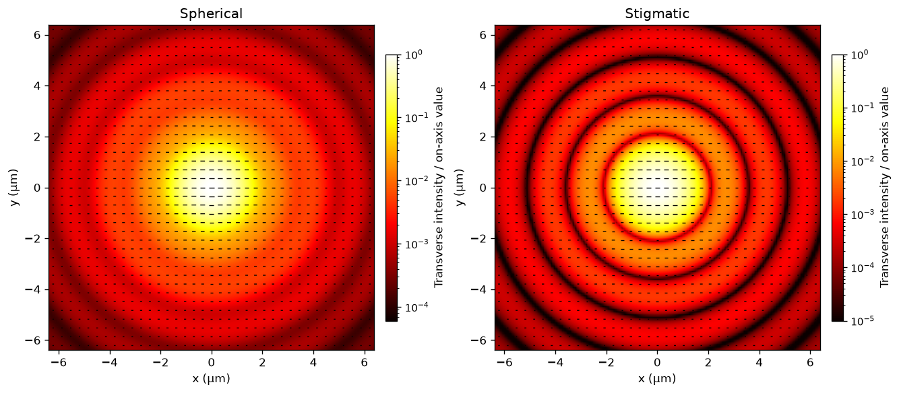
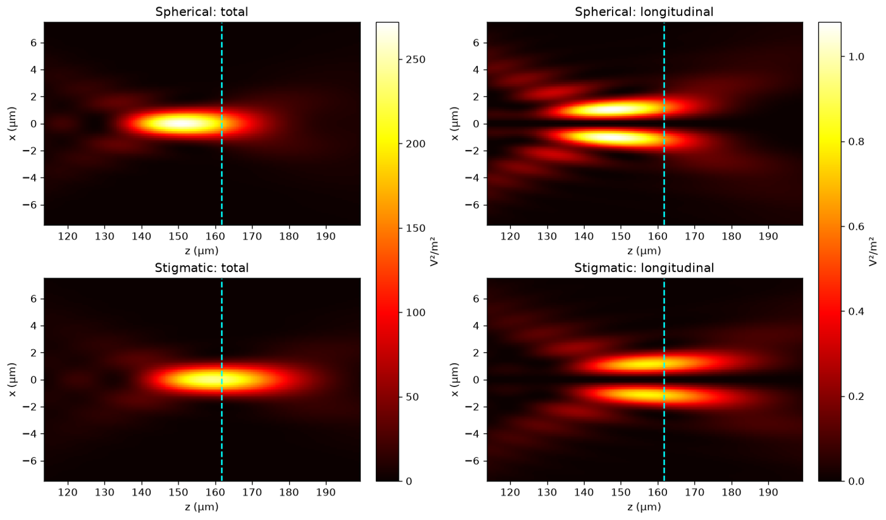
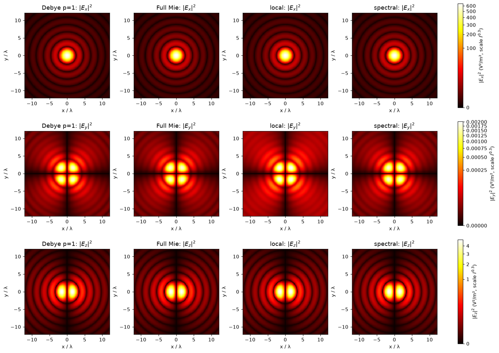
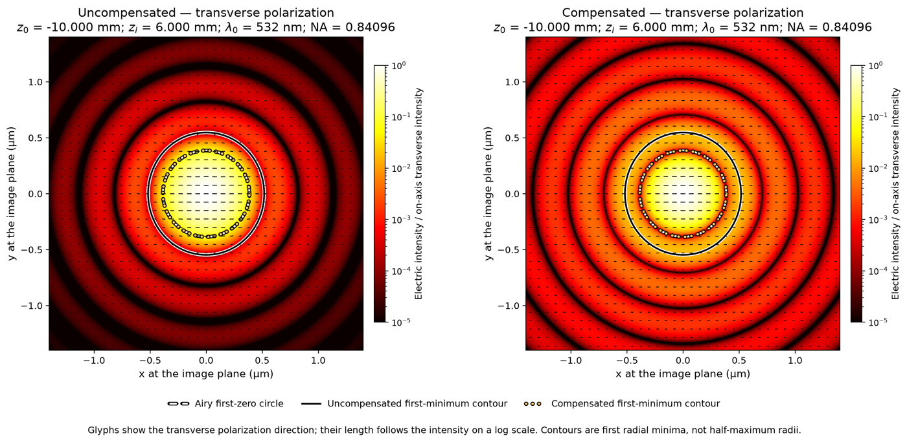
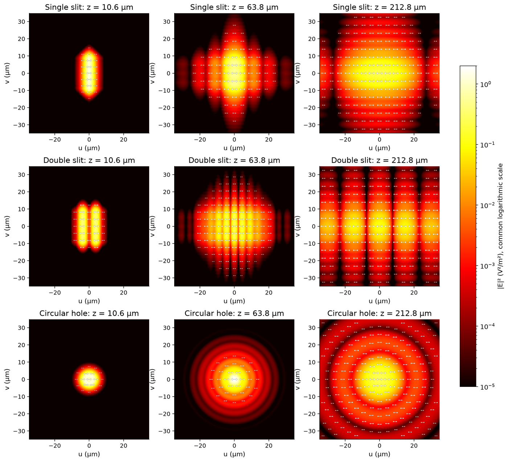
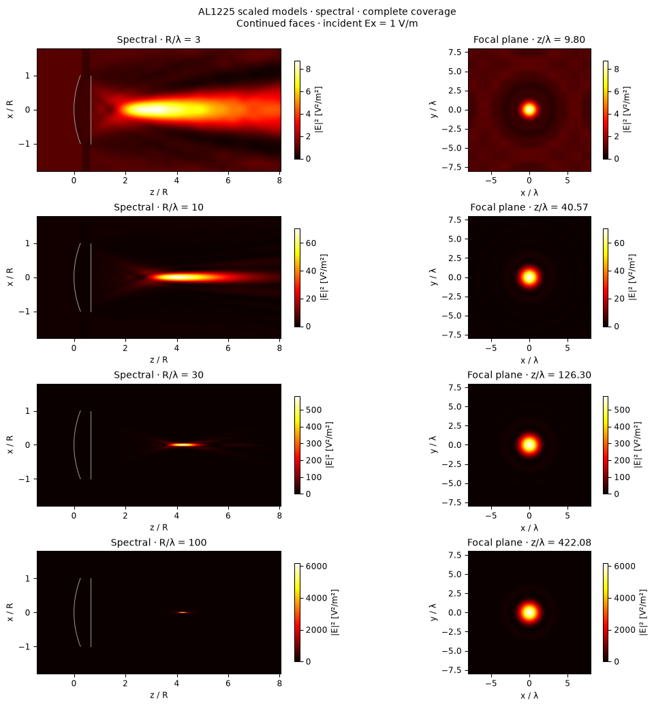

# vecdiff

Vector electromagnetic propagation through optical systems: angular-spectrum
propagation, refraction and reflection at curved dielectric interfaces with
per-wavevector Fresnel transmission, and focusing to the image plane.

<p align="center">
  
  
</p>

<p align="center">
  <em>Instantaneous focal field <code>Re[E e<sup>-i&omega;t</sup>]</code> of the Cartesian-oval
  lens of notebook 03 over two optical cycles: arrows show the transverse field over its
  time-averaged intensity (scale I<sup>0.3</sup>, so the secondary maxima stay visible).
  Linear-x input (left) oscillates; circular input (right) rotates.</em>
</p>

## Results

Figures from the executed [notebooks](docs/NOTEBOOKS.md), all computed with the current code.

<p align="center">
  
</p>

**Lens focusing (notebook 03).** A plane–convex glass lens (n = 1.5, exit radius 120λ, λ = 532 nm)
through wave transport (`alternatives.WavePropagator`) with spectral Fresnel transmission. Focal-plane transverse intensity and
polarization: the spherical exit face (left) blurs the focus by spherical aberration; the Cartesian-oval
exit face (right) gives a sharp Airy pattern with dark rings.

<p align="center">
  
</p>

**Through focus (notebook 03).** Total and longitudinal (|E<sub>z</sub>|²) electric intensity in the
meridional plane for both exit faces (scale I<sup>0.3</sup>); the dashed line marks the nominal image plane.

<p align="center">
  
</p>

**Macroscopic sphere, R/λ = 100 (notebook 07).** Focal |E<sub>x</sub>|², |E<sub>y</sub>|², |E<sub>z</sub>|²
from local and spectral Fresnel propagation through the same glass sphere (n = 1.5, illumination
radius 35λ), beside the first transmitted Debye term (p = 1) and the full Mie field, which includes
additional scattering (scale I<sup>0.3</sup>, so the rings are visible).

<p align="center">
  
</p>

**Fresnel compensation in a stigmatic diopter (notebook 04).** Ray-tube/Debye focus at NA ≈ 0.84 with
and without compensating the Fresnel transmission. The compensated first minimum (gold dashes) lies on
the Airy first-zero circle (black); the uncompensated one (cyan) is wider.

<p align="center">
  
</p>

**Diffraction by apertures (notebook 02).** Vector angular-spectrum propagation behind a single slit,
a double slit and a circular hole at three distances, on a common I<sup>0.3</sup> intensity scale, with
the transverse polarization.

<p align="center">
  
</p>

**Thorlabs AL1225 (notebook 06).** Spectral wave-transport fields of the catalog asphere, geometrically
scaled to R/λ = 3, 10, 30 and 100: meridional and focal-plane |E|².

## Eikonal–angular-spectrum transport

vecdiff carries vector fields through macroscopic curved interfaces with the eikonal–angular-spectrum method of the manuscript. `propagation.Propagator(system)(light)` is that method; it returns a `Solution` whose `field(...)` gives E and H on any target.

- **Across each surface** the field follows its carrier by the plane–surface–plane map, with the flux factor and the continued Fresnel dyadic, and analytic Jacobians (Appendix A).
- **Between surfaces** it is an exact angular spectrum.
- **Sequences** follow the refracted ray family (Appendix B).
- **Surfaces:** planes, spheres, aspheres, Cartesian ovals (real or virtual conjugates), cylinders and freeforms, as graph caps or as closed surfaces.
- **Rotationally symmetric systems** run on one meridian with a fast Hankel sum. The manuscript's aplanatic sphere at 1000 λ0 takes about a second and reproduces the archived method to seven digits (0.1417746 %).
- **Exact references** for checking: `MieSphere`, `LayeredSphere` and `InfiniteCylinder`, each with its Debye terms.

The [propagation guide](docs/PROPAGATION.md#eikonal-transport) describes the method, its options and the regression against the handoff's table. [Notebook 08](general/notebooks/08_eikonal_angular_spectrum_transport.ipynb) shows it in use, and [the plano-convex example](general/examples/plano_convex_lens.py) is the shortest complete script. `alternatives.WavePropagator` keeps the exact surface transport for fields without a carrier, as a check.

## Documentation

- [Notebooks](docs/NOTEBOOKS.md): eight executed optical studies using the current methods.
- [Architecture](docs/ARCHITECTURE.md): responsibilities, units and source map.
- [Propagation](docs/PROPAGATION.md): homogeneous propagation, the R Q⁻¹ T Q R path and eikonal transport.
- [Fourier API and grids](docs/FOURIER_AND_GRIDS.md): Cartesian, polar and nonuniform transforms with physical coordinates.
- [Validation](docs/VALIDATION.md): tests, full-wave references (BEM, FEM, Mie) and their limits.

## Install and verify

Python 3.10 or newer is required. The library is pure Python:

```sh
python3 -m venv .venv
.venv/bin/python -m pip install -e './general[test,notebooks,nufft]'
```

The independent solvers in `validation/` and the sibling stigmatic package are
only needed to run the whole test suite. The validation package builds a
Fortran extension and needs a C and a Fortran compiler (tested with gfortran):

```sh
.venv/bin/python -m pip install meson-python ninja 'numpy>=2'
.venv/bin/python -m pip install --no-build-isolation './validation[test,mesh]'
.venv/bin/python -m pip install -e './stigmatic[test,notebooks,nufft]' ruff
.venv/bin/python -m pytest -q
.venv/bin/ruff check .
.venv/bin/ruff format --check .
```

NumPy and SciPy are required. Matplotlib, Jupyter execution, FINUFFT and Gmsh
(`reference-mesh`) are optional extras; the `cuda12` or `cuda13` extra installs
CuPy for a CUDA GPU (see [GPU backend](#gpu-backend)). `requirements-dev.lock`
records the qualified development environment; the root `pyproject.toml`
configures code style. See [notebooks](docs/NOTEBOOKS.md) to execute the
notebooks.

## Organization

The code separates physical data from algorithms:

```text
vecdiff/
    geometry/       coordinate frames
    surfaces/       surface shapes and normals
    sampling/       grids and integration measures
    media/          material properties and spatial assignment
    fields/         light: beams, sampled fields, carriers, and the Spectrum of a region
        spectrum.py             Spectrum (the interface), PlaneSpectrum (FFT lattice)
        lattice_spectrum.py     LatticeSpectrum, the output of a lattice leg
        hankel_spectrum.py      HankelSpectrum, the output of a meridian leg
        beam_spectrum.py        BeamSpectrum, a beam charted on a plane
    backend.py      CPU (NumPy) or CUDA GPU (CuPy) arrays
    system.py       surface/media adjacency and optical prescriptions
    fourier/        numerical transforms
    transport/      the method: a field across a surface along its carrier's rays
        rays.py                 plane-surface-plane ray map, its Jacobian and caustic index
        dyadic.py               continued Fresnel dyadic and fans of rays
        lattice.py              the leg on a lattice, for any geometry
        meridian.py             the leg on one meridian, for systems of revolution
        report.py               what a leg could not carry
    propagation/    general propagation
        homogeneous.py          propagation in a homogeneous medium (ASM/Fresnel)
        propagator.py           the method: Propagator(system)(light) -> Solution
        coverage.py, targets.py which region holds each point of a target, and sampling
    observables/    energy, power, momentum, spin, forces, polarization, detectors
    references/     exact solutions to check against: Mie, layered sphere, cylinder
    alternatives/   other methods: WavePropagator (wave transport), its Fresnel treatments
    visualization/  plots and animations
```

Angular-spectrum **construction** belongs to `fields/`; evolution in a
homogeneous medium belongs to `propagation/homogeneous.py`. Surface geometry
and adjacent materials are specified independently of the interaction model.
A system can contain zero, one or several optical boundaries.

Public objects are used through these namespaces, for example
`surfaces.SphericalCap` or `propagation.Propagator`; the package top
level re-exports nothing.

Independent full-wave solvers (boundary elements, finite elements, the method
of fundamental solutions), the comparisons built on them and their Fortran
extension live in `validation/` as a separate package, `vecdiff_validation`.
The library itself is pure Python.

## GPU backend

As in diffractsim, one global switch moves arrays and computation to a CUDA GPU.
Make it at the top of a script, before building any vecdiff object:

```python
from vecdiff import backend

backend.set_backend("CUDA")   # "CPU" is the default
```

Everything built and computed afterwards lives on the GPU, in double precision;
results match the CPU to roundoff. NumPy arrays and lists passed in are moved to
the device on entry, results stay there until `backend.to_numpy(array)`, and
plotting converts on its own. Objects built before a switch keep their arrays on
the old device and must be rebuilt. Geometry, meshing, the reference solvers in
`references` and FINUFFT compute on the CPU; their inputs and results
are moved for them. `backend.bd` is the current array module (NumPy or CuPy) for
creating arrays on the same device. `VECDIFF_BACKEND=CUDA pytest general/tests`
runs the test suite on the GPU.

The gain depends on the operation. On a laptop RTX 4060 (8 GB) against 16 CPU
threads, focal maps of a `FocusedBeam` run about 14× faster, angular-spectrum
propagation of a 2048² field 10×, an order-1 Hankel transform 37× and the
curved-surface transfer `SurfaceTransport` 6–9×, all matching the CPU to
roundoff. Device memory bounds the lattice: angular-spectrum propagation holds
about 3 GB at 2048². FINUFFT stays on the CPU: in double precision it outpaces
cuFINUFFT on consumer cards.

## Physical contracts

- Lengths and vacuum wavelength are metres. Public E and H are SI phasors in V/m and A/m; time dependence is `exp(-i omega t)`.
- `ElectricField(grid, wavelength0, values)` owns electric samples, with convenient `Ex`, `Ey`, `Ez` views. It has no medium or duplicate sampling state.
- `Grid` owns physical coordinates, placement, and any integration measure. `PlaneGrid` components use a declared right-handed frame; complete E values are global Cartesian vectors.
- A beam (`fields.PlaneBeam`, `fields.FocusedBeam`) is a source-free sum of propagating plane waves in one region. It takes a scalar `profile` from `fields.profiles` and a separate `polarization` state from `fields.polarization` (x, y, radial, azimuthal or any Cartesian/polar pair), evaluates anywhere through a quadrature chosen for the evaluation region, and declares its reference rays as a `fields.Carrier`.
- `TransverseElectricField` prescribes two local plane components. Longitudinal completion needs the material dispersion and a branch supplied separately. A complete electric vector is validated, never silently projected.
- Material context belongs to regions and systems. `MaterialDistribution` represents piecewise spatial `n(r)`; a geometrical body does not imply that a solver includes its rim scattering.
- A solution computes consistent H from its spatial/modal representation. `ElectromagneticField` holds evaluated E/H; its `poynting()` and `power()` preserve coherent interference.
- `norm2()` is electric amplitude squared. It is not labeled intensity in W/m². Energy density takes explicit nondispersive material context.
- Momentum observables use the dual-symmetric densities of Berry and Bliokh–Bekshaev–Nori: `observables.spin_density` and `helicity_density` read E/H samples; `canonical_momentum`, `spin_momentum` and `orbital_angular_momentum` read an `ElectricFieldJet` (`observables.plane_wave_jet(expansion, grid)`), with ε μ P = p_o + ∇×S/2. `observables.force` and `torque` integrate the Maxwell stress tensor over a closed surface quadrature.

## A propagation

```python
import numpy as np
from vecdiff import fields, media, sampling

wavelength = 532e-9
region = media.HomogeneousRegion("air", media.Dielectric(1.0))
axis = (np.arange(64) - 32) * wavelength / 2
grid = sampling.PlaneGrid(axis, axis)

radius_squared = np.sum(grid.points[..., :2] ** 2, axis=-1)
envelope = np.exp(-radius_squared / (3 * wavelength) ** 2)
values = np.stack((envelope, 0.3j * envelope), axis=-1)
electric = fields.TransverseElectricField(grid, wavelength, values)

spectrum = fields.angular_spectrum(electric, region, evanescent="discard")
propagated = spectrum.propagate(10 * wavelength, model="asm")
power_in_watts = propagated.power()
```

An interface normal points from its `minus` region into its `plus` region. `scatter_plane` retains reflected and transmitted expansions, including evanescent transmission under TIR. `propagation.Propagator(system)(light, carrier=None)` takes a beam from `fields` (which brings its own carrier), a sampled field or a `fields.Spectrum`, and returns a `Solution`: one spectrum per region (`solution.spectra`), one `TransportReport` per refracting surface (`solution.reports`, printed by `print(solution)`), and `solution.field(target)` with E and H on a target (`z=f`, `y=a`, `x=b`, a placed surface or a grid). It carries the field along its carrier with the plane–surface–plane map of the eikonal–angular-spectrum formulation (see [eikonal transport](docs/PROPAGATION.md#eikonal-transport)). `alternatives.WavePropagator(system, transmission="local" | "spectral")` keeps the exact surface transport, for fields without a carrier, and returns the same `Solution`; see the [wave-transport example](general/examples/wave_transport.py).

## Qualification and limits

Read [validation](docs/VALIDATION.md) for the reference checks and measured
errors. The propagation through curved surfaces is a forward approximation. Its current
transport uses a finite, periodic FFT chart and a declared propagating angular
band. Finite material edges, stops and returning branches are outside the
propagators' supported model (the legs can reflect; the propagators do not
yet compose reflections). Exact planar scattering and complete reference
transfer have different, explicitly documented spectral coverage.

## License

Original project code and documentation are licensed under the [Apache License 2.0](LICENSE).
Third-party code, publications, datasets, fonts, and other assets retain their
respective licenses and copyright notices; this license does not replace them.
